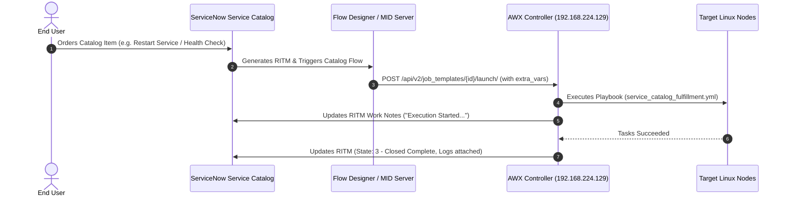

# ServiceNow Service Catalog Integration with Ansible AWX / AAP

This guide provides end-to-end instructions for integrating a **ServiceNow Developer Instance (PDI)** with your local **AWX / Ansible Automation Platform** to fulfill requests through the **ServiceNow Service Catalog**.

---

## 1. Architectural Overview



---

## 2. Network Connectivity: PDI to Private Lab

Your ServiceNow Developer Instance (`https://devXXXXX.service-now.com`) runs in the public cloud, whereas AWX runs in your private network (`192.168.224.129`). Choose one of the following methods to allow ServiceNow to reach AWX:

### Option A: ServiceNow MID Server (Enterprise Standard - Recommended)
1. In ServiceNow, navigate to **MID Server > Downloads** and download the installer (Linux or Windows).
2. Install the MID Server inside your home/lab network (e.g., on Windows or an Ubuntu VM).
3. The MID Server makes an **outbound** connection over HTTPS (port 443) to your ServiceNow instance.
4. When Flow Designer executes a REST call to `http://192.168.224.129`, it routes the request through this MID Server—requiring **no open inbound firewall ports or public IPs**.

### Option B: Cloudflare Tunnel or ngrok (Fastest for Developer Testing)
Expose AWX port 80/443 to a temporary secure public URL:
```bash
# Using ngrok:
ngrok http http://192.168.224.129:80

# Or using Cloudflare Tunnel:
cloudflared tunnel --url http://192.168.224.129:80
```
Use the generated public URL (`https://<id>.ngrok-free.app`) in ServiceNow Flow Designer.

---

## 3. AWX Configuration

### Step 3.1: Create an Application Token in AWX
1. Log in to AWX (`http://192.168.224.129`).
2. Navigate to **Users > (Select your user) > Tokens**.
3. Click **Add Token**, set description to `ServiceNow Integration`, and scope to `Write`.
4. Copy the generated **Bearer Token** (you will use this in ServiceNow).

### Step 3.2: Configure the Job Template
1. In AWX, navigate to **Templates > Add > Add job template**.
2. Name: `ServiceNow - Service Catalog Fulfillment`
3. Inventory: `Production` (`inventories/prod/hosts.ini`)
4. Project: `Ansible Playbooks` (Synced from `Deepan99/ansible_playbooks`)
5. Playbook: `playbooks/servicenow/service_catalog_fulfillment.yml`
6. Check the box: **Prompt on launch** for **Variables** (this allows ServiceNow to pass `extra_vars`).
7. Note down the **Template ID** from the browser URL (e.g., `/templates/job_template/12/details` -> ID is `12`).

---

## 4. ServiceNow Configuration

### Step 4.1: Create the Service Catalog Item
1. In ServiceNow, navigate to **Service Catalog > Catalog Definitions > Maintain Items**.
2. Click **New**:
   - **Name**: `Linux Server Automated Maintenance`
   - **Catalogs**: `Service Catalog`
   - **Category**: `Can We Help You?` or `IT Services`
3. Under the **Variables** related list, click **New** and add the following form fields:

| Type | Question / Label | Name | Values / Options |
| :--- | :--- | :--- | :--- |
| **Single Line Text** | Target Hostname / IP | `target_host` | e.g., `web01.production.internal` |
| **Select Box** | Maintenance Action | `action_type` | `health_check` (Health Check), `restart_service` (Restart Service), `disk_cleanup` (Disk Cleanup) |
| **Single Line Text** | Service Name (if restarting) | `target_service` | e.g., `nginx` or `sshd` |

4. Click **Submit**.

---

### Step 4.2: Create the Flow in Flow Designer
1. Navigate to **Process Automation > Flow Designer**.
2. Click **Create Flow** > Name: `Fulfill Linux Automation Request`.
3. **Trigger**:
   - Trigger type: **Service Catalog** (Runs when a Catalog Item is ordered).
4. **Action 1 - Get Catalog Variables**:
   - Action: **Get Catalog Variables**
   - Submitted Item: `Trigger -> Requested Item Record`
   - Template Catalog Item: `Linux Server Automated Maintenance`
   - Select variables: `target_host`, `action_type`, `target_service`.
5. **Action 2 - Call AWX REST API (Launch Job Template)**:
   - Add Action: **REST step** (via Action Designer or Outbound REST Message).
   - **Endpoint**: `https://<your-awx-host-or-tunnel>/api/v2/job_templates/12/launch/`
   - **HTTP Method**: `POST`
   - **Headers**:
     - `Authorization`: `Bearer <YOUR_AWX_TOKEN>`
     - `Content-Type`: `application/json`
   - **Request Body**:
```json
{
  "extra_vars": {
    "sn_instance": "devXXXXX.service-now.com",
    "sn_username": "admin",
    "sn_password": "YourServiceNowPasswordOrToken",
    "ritm_number": "{{Trigger.current.number}}",
    "target_host": "{{Get Catalog Variables.target_host}}",
    "action_type": "{{Get Catalog Variables.action_type}}",
    "target_service": "{{Get Catalog Variables.target_service}}"
  }
}
```
6. **Action 3 - Update RITM Status**:
   - Set RITM State to `Work in Progress`.
7. Click **Save** and **Activate**.

---

## 5. End-to-End Testing

1. Open the ServiceNow **Service Portal** (`https://devXXXXX.service-now.com/sp`).
2. Search for **Linux Server Automated Maintenance**.
3. Fill in:
   - Target Hostname: `192.168.224.131` (or `infra-node`)
   - Maintenance Action: `Health Check`
4. Click **Order Now**.
5. Observe:
   - In ServiceNow: An `RITM` number is generated (e.g., `RITM0010001`).
   - In AWX: A new job starts automatically under **Jobs**.
   - In ServiceNow: The RITM's **Work Notes** update with:
     > `[Ansible Automation] Execution started for action 'health_check' on target host '192.168.224.131'.`
   - Once completed, the playbook updates the RITM state to **Closed Complete**.

---

## 6. Security Best Practices
- **ServiceNow Credentials**: Rather than passing cleartext credentials in `extra_vars`, store them as a Custom Credential or Encrypted Variable in AWX and refer to them via environment variables (`SN_USERNAME`, `SN_PASSWORD`).
- **Service Account**: Create a dedicated ServiceNow service account (e.g., `ansible_integration_svc`) with minimal roles (`itil` and `catalog_admin`) instead of using the primary `admin` account.
